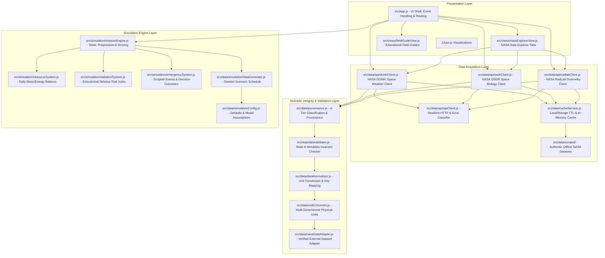

# LunarBase Project Architecture

LunarBase uses a decoupled, modular architecture that enforces clean separation of concerns across presentation, data acquisition, scientific integrity, caching, and simulation logic.

---

## 1. Architectural Layers

---

## 2. Module Responsibilities

### Presentation Layer
- **`src/app.js`**: Application controller, layout shell, routing between 20+ mission screens, DOM event binding, and reactive render loop.
- **`src/views/nasaExplorerView.js`**: Interactive NASA research center rendering 5 tabs: Space Weather (DONKI), Space Biology (OSDR), Radiation Dosimetry (RadLab), Lunar Environment (LRO Diviner/SVS), and Scientific Integrity Guide.
- **`src/views/fieldGuideView.js`**: Pedagogical modules providing structured educational explanations (*What it is*, *Why it matters*, *How it affects a lunar base*, *What to observe*).

### Data Acquisition & Caching Layer
- **`src/data/api/apiClient.js`**: Resilient HTTP client using `AbortController` timeouts and classifying errors (Rate Limit 429, Auth 403, Not Found 404, Server Error 500+, CORS / Network offline).
- **`src/data/api/donkiClient.js`**: Space weather client querying solar flares, CMEs, SEPs, and geomagnetic storms. Manages user API keys with client-side transparency disclosures.
- **`src/data/api/osdrClient.js`**: NASA Open Science Data Repository client for querying space biology studies and accession records.
- **`src/data/api/radlabClient.js`**: NASA RadLab client retrieving physical dosimetry records and environmental benchmarks.
- **`src/data/cacheService.js`**: Caching layer with configurable TTL, localStorage persistence, and graceful in-memory fallback.
- **`src/data/curated/`**: Authentic, peer-reviewed offline fallback records ensuring the application functions 100% offline.

### Scientific Integrity Layer
- **`src/data/provenance.js`**: Enforces the 3-tier data classification (`REAL_NASA_DATA`, `RESEARCH_EVIDENCE`, `SIMULATED_DATA`) and validates mandatory metadata fields.
- **`src/data/dataValidator.js`**: Range and type validation for mission states, model parameters, and external datasets.
- **`src/data/unitConverter.js` & `src/data/dataNormalizer.js`**: Validates dimensional consistency and converts compatible engineering units ($\text{Pa}$, $\text{kPa}$, $\text{K}$, $^\circ\text{C}$, $\text{L}$, $\text{m}^3$, $\text{kg}$, $\text{kWh}$, $\text{kW}$).
- **`src/data/nasaDataAdapter.js`**: Requires explicit verification flag (`verified: true`) and provenance before external data can enter system calculations.

### Simulation Engine Layer
- **`src/simulation/missionEngine.js`**: Pure functional state transition manager handling daily ticks, operational stages (`briefing`, `operations`, `complete`), pause state, and final scoring.
- **`src/simulation/resourceSystem.js`**: Mathematical resource balances (metabolic oxygen, gross water recycling, rationed food, solar yield vs. electrical loads) with non-negative clamping.
- **`src/simulation/radiationSystem.js`**: Generates educational relative risk indices ($0\text{--}100$) and handles storm shelter attenuation.
- **`src/simulation/emergencySystem.js`**: Deterministic emergency generator linked to daily scenario triggers and resolving crew decision trade-offs.

---

## 3. Deployment Architecture

- **Host**: GitHub Pages (Static hosting).
- **CI/CD**: GitHub Actions workflow in `.github/workflows/deploy.yml` builds with Node.js 22, runs automated tests, sets `VITE_BASE_PATH: /unarbase-mission-survival/`, and deploys `./dist`.
- **Zero Server Overhead**: Operates entirely client-side without paid servers or backend dependencies.
